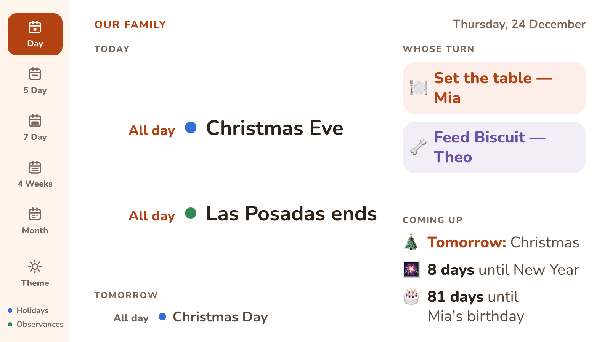
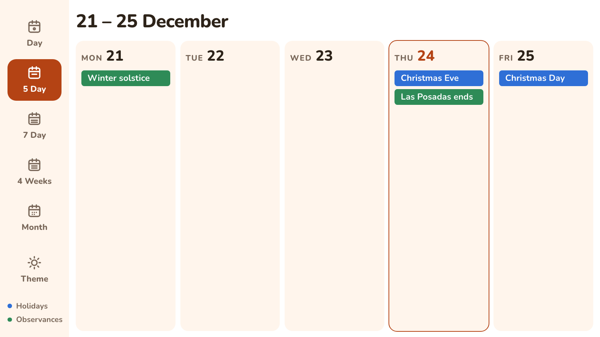
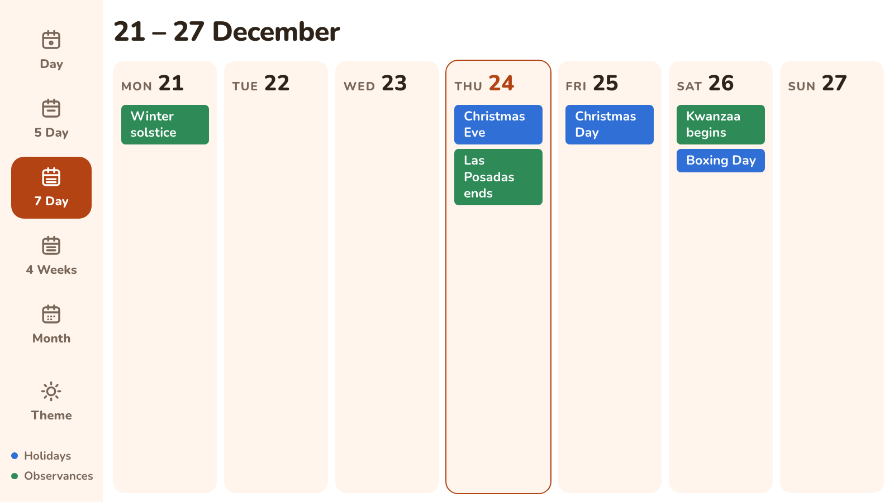
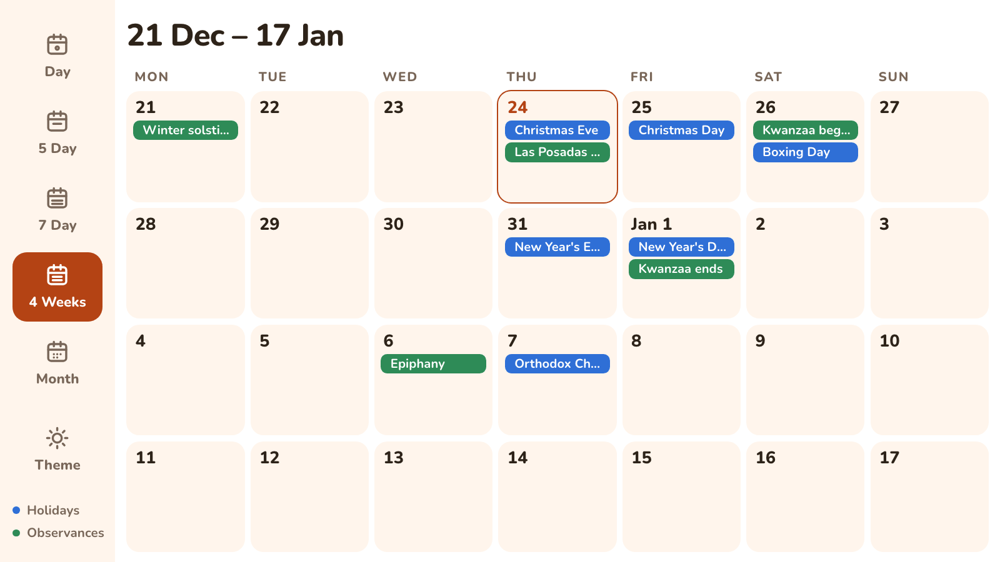
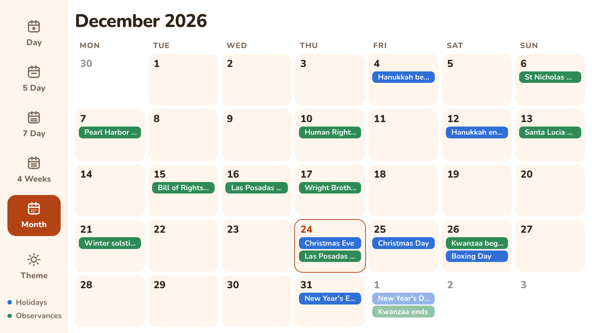
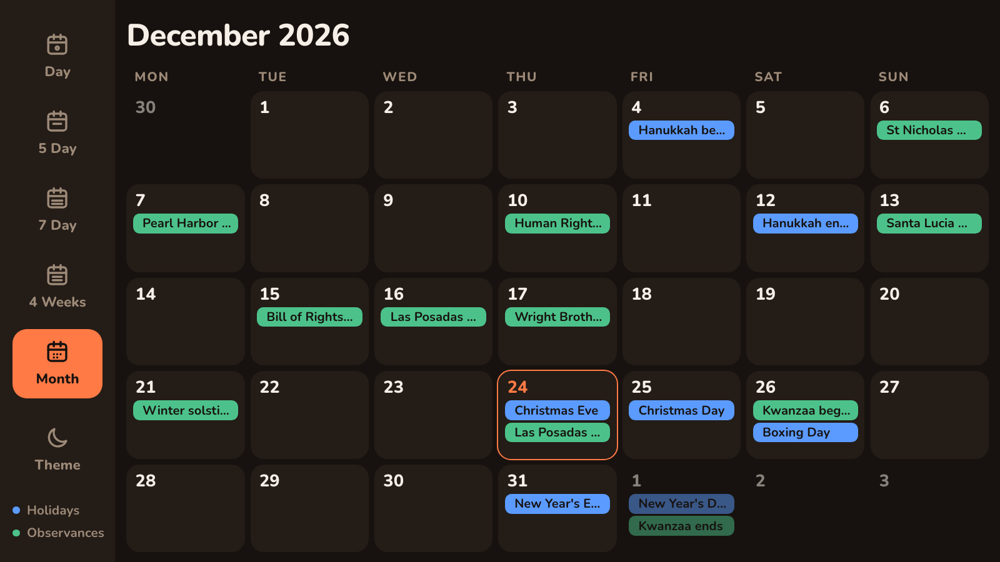
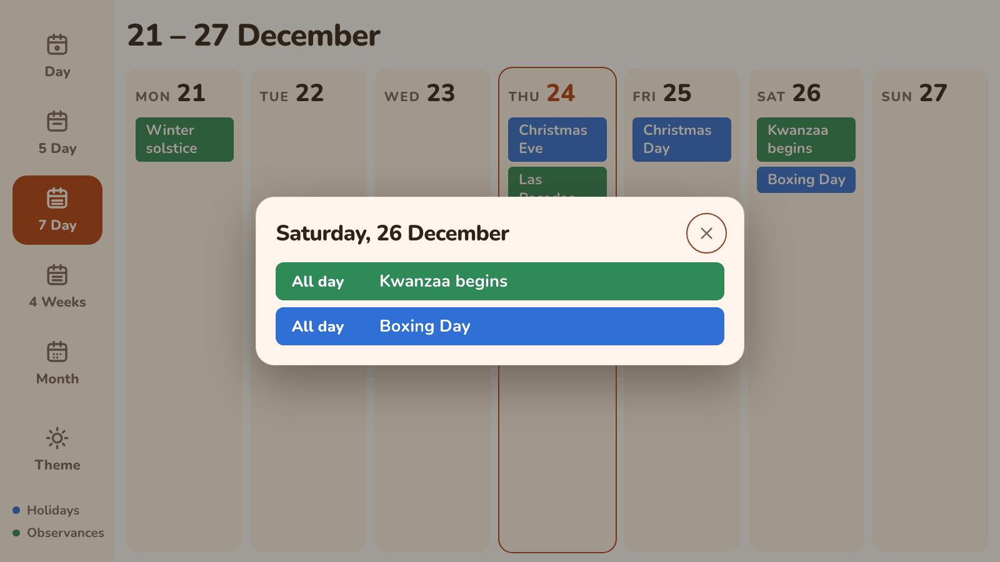

# DinkyDash

The digital family calendar for screens you already own — a TV, an old tablet, or a Raspberry Pi.



Website: [dinkydash.co](https://dinkydash.co)

DinkyDash merges your calendars into one agenda, works out whose turn each chore is, and counts down to the next birthday. Then it puts the lot on a screen at home — light or dark, sized to read from across the kitchen. A sidebar switches between today, a week, four weeks and the whole month.

## Two ways to run it

**Self-hosted (this repo).** Free, MIT-licensed, runs on your own hardware. If you want the daily headline it uses your own Anthropic API key; with `ai_headline: false` it needs none. Setup takes an afternoon and some comfort with a terminal.

> Self-hosting is **community-supported**. Issues and pull requests are welcome, but there's no support commitment — if you need it to just work, use the hosted version.

**Hosted.** [Start a free 14-day trial.](https://app.dinkydash.co/login) No card required. After that it's $39 a year or $6 a month, and nothing is charged unless you choose to subscribe. Built from this same repo, in cloud mode — see [Two modes, always](CLAUDE.md#two-modes-always).

## What the dashboard shows

- Today's agenda, in time order, merged from as many Google, Apple iCloud and Outlook
  calendars as you like — anything with an iCal link, pasted in, no account sign-in
- A personal calendar can show only the events shared with your partner, and keep
  work and private appointments to itself
- A look at tomorrow underneath it, on the days today leaves room
- Whose turn each chore is — it moves on with the date, nothing to tick off
- Countdowns to birthdays, holidays and special dates
- Five views, from today to the whole month, each calendar in its own colour
- Light or dark, flipped from the sidebar or set in the settings UI

Configure all of it from your phone at `/settings`, or by editing `config.yaml` directly — they are
the same file, and the UI keeps your comments.

### Views and the sidebar

The sidebar on the left (along the top of a phone or a portrait screen) switches the view:

- **Day** — today's agenda, whose turn each chore is, and what's coming up.
- **5 Day** — Monday to Friday of this week, a card for each day.
- **7 Day** — the whole week, a card for each day.
- **4 Weeks** — this week as the top row, then the next three weeks. It's the one for seeing what's coming.
- **Month** — the calendar month, with the days either side greyed out.

A few things worth knowing:

- **Each calendar gets its own colour**, by the order you list them in `config.yaml`, and an event keeps it in every view. On wide screens the sidebar names which colour is which.
- **Start times show in the week views.** The month and 4 Weeks views show titles only, so a full grid stays readable. A day with more events than fit says "+3 more".
- **Tap or click a day** in any view except Day to open the whole day in a card, with times and locations. It closes with the ✕, Esc or a tap outside, and on its own after a minute, so a wall screen is never left covered.
- **The Settings link** at the foot of the sidebar opens the settings page in a new tab. It's on the self-hosted dashboard only; a hosted screen has no way into settings, on purpose.
- **The Theme button** flips light and dark. The view and the theme you pick are remembered by that screen's browser, so a kitchen panel and a phone can differ. Until you pick, the `theme` in `config.yaml` decides.
- **Weeks start on Monday.** Set `week_start: sunday` in `config.yaml` to change it. The 5 Day view is always Monday to Friday.

### The views

Every screenshot here is invented: a made-up family with two sample calendars that hold nothing
but public holidays.

**Day** — today, tomorrow underneath, and the chores and countdowns beside it.


**5 Day** — Monday to Friday, a card for each day.



**7 Day** — the whole week.



**4 Weeks** — this week as the top row, then the next three.



**Month** — the calendar month, titles only.



**Dark** — the same views with the Theme button flipped.



**A day, in full** — tap or click any day outside the Day view.



### The daily headline

Once a day, at a time you set, DinkyDash can ask Claude to write a headline for the day, and it keeps it with the dashboard. The dashboard doesn't show it at the moment. If you'd rather not spend anything on it, set `ai_headline: false` in `config.yaml`: nothing calls the model at all, and the calendars still refresh. The settings page hides its two "write a daily message" buttons when it's off.

## How it works

```
[cron every 5m] → generate.py --tick → every hour: re-fetches every iCal feed, in time order
                                     → once a day at a time you set, 06:00 by default
                                       (and at once on the first run): calls Claude,
                                       unless ai_headline is false
                                     → saves dashboard_data.json

[browser]       → web/routes/board.py → recomputes chores, countdowns and today's agenda
                                      → renders the dashboard
```

Only the headline comes from the model. Ages, countdowns, chore turns and every agenda in
every view are recomputed on every render, so if a day's run fails the times and turns on the
wall are still today's.

The calendars are fetched from 37 days back to at least 45 days ahead, so the month and
4 Weeks views always have their whole grid.

---

## Quickstart

You can see the real dashboard in about two minutes, with no API key and nothing to pay for.

```bash
git clone https://github.com/caspii/dinkydash.git
cd dinkydash
python3 -m venv venv && source venv/bin/activate
pip install -r requirements.txt
cp config.example.yaml config.yaml    # edit by hand, or from /settings once it runs
python sample_board.py                # a dashboard for today; calls no API, costs nothing
python app.py
```

- http://localhost:5000 — the dashboard
- http://localhost:5000/settings — configure it from a phone
- http://localhost:5000/preview — Pi, TV and tablet sizes side by side

The chore turns, ages and countdowns are computed from the `config.yaml` you just made, so
editing it and reloading shows your own family. You only need an Anthropic API key for the
daily headline, which the dashboard doesn't show at the moment. Set `ai_headline: false` to run
without one.

**Then follow the [getting started guide](https://dinkydash.co/getting-started/)** — it has
the API key step, where to find your calendar's iCal link for Google, iCloud and Outlook, and
the whole Raspberry Pi build with systemd, kiosk mode and the screen schedule.

> **There is no login.** The dashboard and the settings UI are both served without authentication, so
> anyone who can reach the port can read your family's agenda and rewrite `config.yaml` — names,
> birthdays, and every calendar link in it.
>
> That is deliberate rather than unfinished: DinkyDash is a config file with a web form on it, and
> the file has no login either. It assumes it is on your home network, the same as a printer.
>
> **So keep the port off the public internet.** Do not forward port 5000 on your router. If you need
> it from outside the house, reach it over a VPN such as [Tailscale](https://tailscale.com) or
> [WireGuard](https://www.wireguard.com), or put a reverse proxy with basic auth in front of it.
>
> Hosted mode is a different matter — it authenticates every request and is scoped per family. See
> [Hosted mode raises the stakes](CLAUDE.md#hosted-mode-raises-the-stakes).

---

## Documentation

| What you want | Where it is |
|---|---|
| Install it, and put it on a Raspberry Pi | [dinkydash.co/getting-started](https://dinkydash.co/getting-started/) |
| Every config key, with comments | [`config.example.yaml`](config.example.yaml) |
| Living with it: the daily cycle, the two buttons, what to check when something looks wrong | [`doc/running-it.md`](doc/running-it.md) |
| Coming from an older version | [`doc/upgrading.md`](doc/upgrading.md) |
| Working on the code, and how the hosted build shares it | [`CLAUDE.md`](CLAUDE.md) |
| Product terms and UI wording | [`doc/terminology.md`](doc/terminology.md) |

The install and Pi guides live on the website rather than here, so there is one copy of each
to keep right.

## Local hosted development

Conductor's **dev** run action starts the hosted dashboard and marketing website
together. The same command outside Conductor is `venv/bin/python dev.py`.
See [local development](doc/development.md) for the required development database
and session key, ports, sign-in, and how Conductor picks up the run configuration.
The self-hosted quickstart above is unchanged.

## Running the tests

```bash
pip install -r requirements-dev.txt   # adds pytest and the website build; not needed on the Pi
python -m pytest tests/ -q
```

The suite runs in seconds. It covers leap years, timezone conversion, event ordering, chore
rotation, the stale-dashboard logic, the config round-trip, and the settings routes that write it.

GitHub Actions runs the same command on every push and pull request, on Python 3.11
(`.github/workflows/test.yml`), alongside a [gitleaks](https://github.com/gitleaks/gitleaks) scan of
the full history. Both dependency files are pinned with `==`, so a clean `pip install` gets the
versions CI passed on. A pull request that fails either check shows a red X.

## Key files

| Path | Purpose |
|------|---------|
| `dinkydash/` | The engine. Pure functions plus the model call — no clock, no file reads |
| `dinkydash/context.py` | Ages, birthdays, countdowns, chore rotation |
| `dinkydash/calendars.py` | iCal fetch, parse, recurrence, merging feeds |
| `dinkydash/board.py` | Turns config + payload into what the dashboard renders |
| `dinkydash/runner.py` | The two halves of the cycle: `refresh_calendars` and `write_brief` |
| `dinkydash/schedule.py` | `due()` — which of the two the clock and the config owe right now |
| `dinkydash/store.py` | Where the config, the dashboard and the note history are kept |
| `migrations/` | The hosted schema, plain SQL. Self-hosting needs none of it |
| `web/` | Flask app — dashboard, settings UI, templates |
| `web/templates/board.html` | The dashboard itself: the sidebar, the five views and the day card, light and dark, all screen sizes |
| `generate.py` | Command-line skin over `dinkydash.runner` — this is what cron calls |
| `app.py` | Flask entry point |
| `config.yaml` | All configuration. The settings UI writes this same file |
| `config.example.yaml` | Template config, documenting every key |
| `tests/` | Over 1,700 tests; the ones that need Postgres skip without it. Run them before committing |
| `doc/` | Running it day to day, and upgrading from an older version |
| `design/` | Mockups for the dashboard and settings UI, with the reasoning |
| `.env` | `ANTHROPIC_API_KEY` (not in git) |
| `.env.example` | The template for it — copy to `.env` |
| `.github/workflows/test.yml` | CI: pytest and gitleaks, on every push and pull request |
| `.gitleaks.toml` | Secret-scanning rules, including one for iCal secret addresses |
| `dashboard_data.json` | The generated payload (not in git) |
| `content_history.json` | A rolling record of the last 30 days' runs (not in git) |

## Contributing

Pull requests are welcome. The codebase is one monorepo serving both the self-hosted and the hosted build, so a change has to work in both modes — read [CLAUDE.md](CLAUDE.md) before starting anything structural, and open an issue first for larger changes.

Known rough edges are listed under "Known issues" in [CLAUDE.md](CLAUDE.md).

## License

MIT — see [LICENSE](LICENSE).
